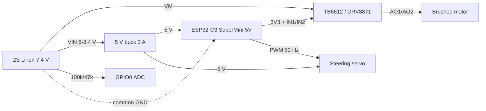

# Hardware notes

## What the photo shows

A small-scale (roughly 1/16) plastic monster-truck chassis:

- four off-road wheels, green spring shocks, independent swing arms
- one central gearbox driving an axle, plastic chassis tub
- electronics removed: only pigtails remain (red/black battery leads and
  two 2-pin JST-style connectors), no steering servo and no servo saver
  visible

So this is a rolling chassis that needs a full electronics retrofit. Confirm
the scale, motor can size and connector pinout before ordering parts.

## What the ESP32-C3 can and cannot do

From the ESP32-C3 datasheet and ESP-IDF 5.5 docs:

| Resource | ESP32-C3 | Consequence |
|---|---|---|
| Core | single RISC-V, 160 MHz, 400 KB SRAM | plenty for WiFi + control loop |
| Radio | WiFi 4 (2.4 GHz) + BLE 5.0 | browser UI or BLE gamepad; no BT Classic |
| MCPWM | **absent** | no dedicated motor PWM peripheral |
| LEDC | 6 channels, 14-bit max duty | used for motor (20 kHz) and servo (50 Hz) |
| RMT | 2 TX channels | fallback for precise servo pulses |
| ADC | ADC1 on GPIO0-4, 12-bit | battery divider on GPIO0 |
| USB | native USB-Serial-JTAG on GPIO18/19 | flash and console without a UART adapter |
| Strapping | GPIO2, GPIO8, GPIO9 | GPIO8 = onboard LED (active low), GPIO9 = BOOT |

Practical limits: 3.3 V logic, so the H-bridge and servo must accept 3.3 V
inputs; the onboard LDO cannot power a servo; no Bluetooth Classic, so a
DualShock 4 will not pair (BLE gamepads and ESP-NOW will).

## Pin map (v0, in `main/config.h`)

| Signal | GPIO | Peripheral | Note |
|---|---|---|---|
| Motor IN1 | 3 | LEDC ch0, 20 kHz | direction + magnitude |
| Motor IN2 | 4 | LEDC ch1, 20 kHz | JTAG pin, debug lost |
| Servo | 5 | LEDC ch2, 50 Hz | 1000-2000 us |
| VBAT | 0 | ADC1 ch0 | 100k / 47k divider |
| Status LED | 8 | GPIO out | onboard, active low, strapping |
| I2C SDA/SCL | 6/7 | reserved | IMU later, JTAG pins |

## Bill of materials

| Part | Choice | Why |
|---|---|---|
| MCU board | ESP32-C3 SuperMini | already chosen; 4 MB flash, USB-JTAG |
| Motor driver | TB6612FNG breakout | dual H-bridge, 1.2 A cont / 3.2 A peak, 2.7-13.5 V, 3.3 V logic |
| Motor driver (alt) | DRV8251A or DRV8871 breakout | 4.1 A / 3.6 A peak for a hot 260/370 motor |
| Steering servo | existing unit | confirm 4.8-6 V rated; power it from 5 V, not 3.3 V |
| 5 V rail | MP1584EN or Pololu D24V22F5 buck | servo + ESP32; 2-3 A |
| Battery | 2S Li-ion 18650 pack (7.4 V) | chosen; needs a 2S BMS and balance charger |
| Bulk cap | 470-1000 uF low-ESR on VM | absorbs motor stall transients |
| Servo connector | 3-pin 2.54 mm | 5 V / GND / signal |
| Switch | inline battery switch | bench safety |
| Optional | MPU6050/ICM-20689 | heading hold, traction data |

Avoid the L298N: about 2 V drop, slow switching, bulky. Use it only if it is
already in a drawer and the car is a bench test.

## Wiring

Details:

- All grounds common: battery, buck, ESP32, H-bridge, servo.
- H-bridge `VCC` (logic) to 3.3 V, `VM` to the battery, `STBY` to 3.3 V.
- Servo signal to GPIO5, servo power to the 5 V buck, never to 3.3 V.
- Battery divider: battery + → 100k → GPIO0 → 47k → GND. 8.4 V maps to
  2.68 V, inside the ADC range.
- Snubber cap across the motor terminals (100 nF) reduces brush noise.
- Keep motor wires away from the antenna end of the SuperMini.
- Firmware treats 6.4 V (5 consecutive 1 s samples) as empty and latches the
  drive off. Adjust `VBAT_CUTOFF_V` if the pack is not Li-ion.

## Power budget (estimate, measure before trusting)

| Load | Typical | Peak |
|---|---|---|
| ESP32-C3, WiFi TX | 80-120 mA | ~350 mA |
| Servo, moving | 150-250 mA | 700 mA |
| Brushed motor, 1/16 truck | 1-3 A | 5 A+ stall |

The buck must supply ESP32 + servo (about 1 A peak); the motor runs straight
from the battery through the H-bridge. Size the H-bridge for stall current,
not cruise current.

## Bring-up checklist

1. Measure the stock motor: winding resistance and stall current at the
   intended pack voltage. Pick the H-bridge from that number.
2. Power the ESP32 alone, confirm the AP and the web UI.
3. Scope GPIO5: 50 Hz, 1.0-2.0 ms pulse, center 1.5 ms.
4. Connect the H-bridge with the motor unloaded; check direction and that
   zero command coasts.
5. Fit the servo, set `SERVO_TRIM_US` so the wheels point straight.
6. Load test on blocks, then ground test with the failsafe.

## Sources

- ESP32-C3 datasheet: <https://www.espressif.com/sites/default/files/documentation/esp32-c3_datasheet_en.pdf>
- ESP-IDF LEDC: <https://docs.espressif.com/projects/esp-idf/en/stable/esp32c3/api-reference/peripherals/ledc.html>
- ESP-IDF HTTP server WebSocket: <https://docs.espressif.com/projects/esp-idf/en/stable/esp32c3/api-reference/protocols/esp_http_server.html>
- ESP-IDF ADC oneshot: <https://docs.espressif.com/projects/esp-idf/en/stable/esp32c3/api-reference/peripherals/adc/oneshot_api.html>
